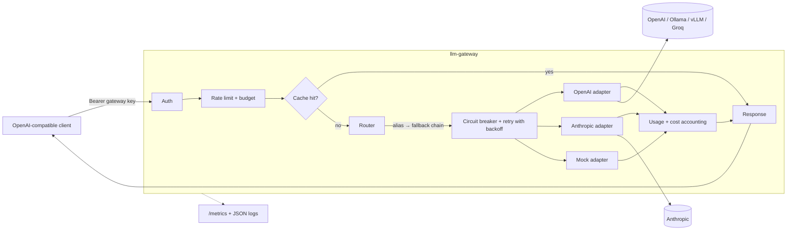

# py-llm-gateway

[](https://github.com/bhavana-sanal/py-llm-gateway/actions/workflows/ci.yml)
[](pyproject.toml)
[](LICENSE)

**A self-hosted, OpenAI-compatible gateway that puts fallback routing, retries, circuit breakers, rate limits, caching and cost tracking in front of any LLM provider.**

Point any OpenAI client at it, change nothing else, and get one endpoint for OpenAI, Anthropic, Ollama, vLLM, Groq, or an offline mock.

## Why a gateway?

Once more than one service calls LLM APIs, the same problems show up everywhere:

- **Providers fail.** 429s, 503s, overloaded errors and timeouts are routine. Every caller ends up writing its own retry loop, usually without backoff jitter or a way to stop hammering an upstream that is down.
- **Switching models is a code change.** Each provider has its own SDK and wire format, so trying another model or adding a fallback means touching every client.
- **Nobody knows what anything costs.** Provider keys are shared, there is no per-team budget, and spend shows up on the invoice a month later.
- **Keys leak.** Real provider keys get copied into every service and CI job.

A gateway solves these once, in one place: clients get a single OpenAI-shaped endpoint and a gateway key; the gateway owns the provider keys, the routing policy and the accounting.

## Features

- **OpenAI-compatible API**: `POST /v1/chat/completions` (including `stream: true` over SSE) and `GET /v1/models`. Works with the official `openai` SDKs, LangChain, curl, etc.
- **Provider adapters** behind one small protocol:
  - `openai`: OpenAI and any compatible server (Ollama, vLLM, Groq, ...) via `base_url`
  - `anthropic`: Anthropic Messages API, translated both ways, including streaming events, system prompts and `stop_reason` → `finish_reason`
  - `mock`: deterministic and offline, so everything runs without keys or network
- **Model aliases with fallback chains**: `smart = ["anthropic/claude-sonnet-5-5", "openai/gpt-5-mini"]`
- **Retries** on 408/429/5xx/timeouts with exponential backoff and full jitter, honoring `Retry-After`
- **Per-provider circuit breaker** (closed → open → half-open) so a dead upstream is skipped instead of retried
- **Gateway API keys** with per-key token-bucket rate limits and optional monthly spend budgets
- **Exact-match response cache**: LRU with TTL, scoped per key, used only for deterministic requests by default
- **Usage and cost accounting** per key and model from a pricing table
- **Prometheus `/metrics`**: requests, latency histogram, tokens, cost, cache hits/misses, provider errors, breaker state
- **Structured JSON logs** with a request ID (taken from `X-Request-ID` or generated) on every line
- Small, fully typed codebase (`mypy --strict`) with four runtime dependencies

## Architecture



For each request the router walks the alias's chain in order. Every target is tried up to `1 + max_retries` times, provided its circuit breaker allows it; a non-retryable error or an open breaker moves on to the next target at once. Every adapter speaks OpenAI chat-completions format to the rest of the gateway, so the router, cache and accounting do not care which provider answered.

| Module | Responsibility |
| --- | --- |
| `app.py` | FastAPI routes, request validation, request-ID middleware, OpenAI-style errors |
| `gateway.py` | Auth, limits, cache, accounting, SSE framing; no HTTP framework code |
| `router.py` | Alias → fallback chain, retries, breakers, stream priming |
| `resilience.py` | Backoff with full jitter, circuit breaker state machine |
| `providers/` | `Provider` protocol plus the OpenAI, Anthropic and mock adapters |
| `cache.py`, `limits.py`, `metrics.py`, `logs.py` | LRU+TTL cache, token bucket and spend ledger, Prometheus registry, JSON logging |
| `config.py` | TOML → validated, immutable pydantic models with `${ENV}` expansion |

## Quickstart

### Local

Requires Python 3.12+. With [uv](https://docs.astral.sh/uv/):

```bash
git clone https://github.com/bhavana-sanal/py-llm-gateway && cd py-llm-gateway
uv sync
cp gateway.example.toml gateway.toml          # edit to taste; gateway.toml is gitignored
uv run llm-gateway --config gateway.toml
```

Or with plain pip:

```bash
python -m venv .venv && source .venv/bin/activate
pip install -e .
llm-gateway --config gateway.example.toml
```

The `mock` alias works right away with no provider keys. To use real providers, export their keys before starting:

```bash
export OPENAI_API_KEY=...  ANTHROPIC_API_KEY=...
```

### Docker

```bash
docker compose up --build                      # gateway on http://localhost:8080
docker compose --profile ollama up --build     # ...plus a local Ollama server
docker compose exec ollama ollama pull llama3.3
```

The image runs as a non-root user, has a health check on `/healthz`, and reads its config from `/etc/llm-gateway/gateway.toml`. Compose mounts `gateway.example.toml` there and passes provider keys through from your shell environment.

## Usage

### curl

```bash
curl http://localhost:8080/v1/chat/completions \
  -H "Authorization: Bearer sk-gateway-dev" \
  -H "Content-Type: application/json" \
  -d '{"model": "mock", "messages": [{"role": "user", "content": "Hello gateway"}], "temperature": 0}'
```

```json
{"id":"chatcmpl-mock-573f01eebcbaa50e","object":"chat.completion","created":1793429895,"model":"mock-1",
 "choices":[{"index":0,"message":{"role":"assistant","content":"Mock response to: Hello gateway"},"finish_reason":"stop"}],
 "usage":{"prompt_tokens":2,"completion_tokens":5,"total_tokens":7}}
```

Response headers tell you what happened: `x-gateway-target: mock/mock-1` (which provider/model served it), `x-cache: miss|hit`, and `x-request-id`.

Streaming:

```bash
curl -N http://localhost:8080/v1/chat/completions \
  -H "Authorization: Bearer sk-gateway-dev" \
  -H "Content-Type: application/json" \
  -d '{"model": "mock", "stream": true, "messages": [{"role": "user", "content": "Stream please"}]}'
```

```text
data: {"id":"chatcmpl-mock-...","object":"chat.completion.chunk",...,"choices":[{"index":0,"delta":{"role":"assistant","content":""},"finish_reason":null}]}

data: {"id":"chatcmpl-mock-...","object":"chat.completion.chunk",...,"choices":[{"index":0,"delta":{"content":"Mock "},"finish_reason":null}]}

...

data: {"id":"chatcmpl-mock-...","object":"chat.completion.chunk",...,"choices":[{"index":0,"delta":{},"finish_reason":"stop"}]}

data: [DONE]
```

### OpenAI Python SDK

```python
from openai import OpenAI

client = OpenAI(base_url="http://localhost:8080/v1", api_key="sk-gateway-dev")

reply = client.chat.completions.create(
    model="mock",  # or "smart", "fast", "local": any alias from [models]
    messages=[{"role": "user", "content": "Hello from the OpenAI SDK"}],
)
print(reply.choices[0].message.content)

for chunk in client.chat.completions.create(
    model="mock", messages=[{"role": "user", "content": "Stream this back"}], stream=True
):
    if chunk.choices and chunk.choices[0].delta.content:
        print(chunk.choices[0].delta.content, end="")
```

A runnable version lives in [`examples/openai_sdk.py`](examples/openai_sdk.py).

### Errors

Errors use OpenAI's shape, so SDKs raise their usual exception types:

```json
{"error": {"message": "Rate limit of 60 requests per minute exceeded.", "type": "requests", "param": null, "code": "rate_limit_exceeded"}}
```

| Status | When |
| --- | --- |
| 400 | invalid request body, or an upstream rejected the request itself |
| 401 | missing or unknown gateway key |
| 404 | unknown model alias |
| 429 | key rate limit (`rate_limit_exceeded`, with `Retry-After`) or monthly budget spent (`insufficient_quota`) |
| 502 | every provider in the chain failed |
| 503 | every provider in the chain has an open circuit breaker |

## Configuration

See [`gateway.example.toml`](gateway.example.toml) for a complete, commented example. Any string value may use `${VAR}` or `${VAR:-default}` to read from the environment, which is how provider keys stay out of the file.

| Section | Key | Default | Meaning |
| --- | --- | --- | --- |
| `[server]` | `host`, `port` | `127.0.0.1`, `8080` | bind address (overridable with `--host`/`--port`) |
| | `log_level` | `info` | `debug`, `info`, `warning`, `error` |
| `[providers.<name>]` | `type` | required | `openai`, `anthropic` or `mock` |
| | `base_url` | provider's public API | e.g. `http://localhost:11434/v1` for Ollama |
| | `api_key` | `""` | sent as `Authorization: Bearer` (openai) or `x-api-key` (anthropic) |
| | `timeout_seconds` | `60` | per network operation (connect, or each read while streaming) |
| | `default_max_tokens` | `4096` | Anthropic only: used when the client omits `max_tokens` |
| `[models]` | `<alias>` | required | ordered list of `"provider/model"` targets |
| `[[keys]]` | `name`, `key` | required | gateway key; `name` is used in metrics and logs |
| | `requests_per_minute` | `60` | token bucket: bursts up to this many, refills continuously |
| | `monthly_budget_usd` | none | requests are refused once month-to-date spend reaches it |
| `[resilience]` | `max_retries` | `2` | retries per target on 408/429/5xx/timeouts |
| | `backoff_base_seconds`, `backoff_max_seconds` | `0.5`, `8` | delay is `uniform(0, min(max, base × 2^attempt))` |
| | `max_retry_after_seconds` | `30` | a longer upstream `Retry-After` falls through to the next target instead |
| | `circuit_failure_threshold` | `5` | consecutive failures that open a provider's breaker |
| | `circuit_reset_seconds` | `30` | time open before a single half-open probe |
| `[cache]` | `enabled` | `true` | |
| | `max_entries`, `ttl_seconds` | `1024`, `300` | LRU capacity and entry lifetime |
| | `cache_nonzero_temperature` | `false` | also cache requests with `temperature > 0` (or unset) |
| `[pricing]` | `"<model>"` | none | `{ input_per_mtok, output_per_mtok }` in USD per million tokens |

### Endpoints

| Method | Path | Auth | Purpose |
| --- | --- | --- | --- |
| `POST` | `/v1/chat/completions` | gateway key | chat completions, streaming or not |
| `GET` | `/v1/models` | gateway key | lists the configured aliases |
| `GET` | `/metrics` | none | Prometheus text format (keep it on an internal network) |
| `GET` | `/healthz` | none | liveness check |

## Design decisions and trade-offs

- **OpenAI format as the internal lingua franca.** Every adapter converts to and from chat-completions JSON at its edge. The router, cache, SSE framing and accounting are written once and never branch on provider. The cost is that features with no OpenAI equivalent (Anthropic's extended thinking blocks, for example) are not exposed.
- **Pass-through, not re-modelling.** Requests are validated only for the fields the gateway relies on (`model`, `messages`, `stream`, `temperature`); unknown fields are forwarded untouched, so new OpenAI parameters work without a gateway release.
- **No retries once a stream has started.** The router pulls the *first* chunk from the upstream before returning, so failures before any byte is sent (connection errors, 429s, 5xx, an immediate error event) are retried and can fall back like any other request. After the first chunk the response status and some content are already on the wire: replaying the request could duplicate or contradict text the client has shown. A mid-stream failure is reported as a final `data: {"error": ...}` event with no `[DONE]` marker, which is how the client can tell the stream is incomplete.
- **Which errors count.** Only retryable failures (408, 429, 5xx, timeouts, connection errors) are retried and count against a provider's breaker. A 400 or 401 means the upstream is up and answered, so it falls through to the next target without retrying or tripping the breaker. When the last target in the chain rejects the request with 400/404/413/422, that status is passed back to the client; any other final failure becomes 502.
- **`Retry-After` beats our own backoff, up to a point.** If an upstream asks for a wait longer than `max_retry_after_seconds`, the next provider in the chain is the faster option.
- **Full-jitter backoff.** `uniform(0, cap)` rather than a fixed exponential schedule, so clients that failed together don't retry together.
- **Half-open allows one probe at a time.** If that probe never reports back (say the client disconnected), the breaker simply grants another probe after the next reset period instead of getting stuck.
- **Cache is conservative.** It caches only non-streaming requests with `temperature: 0` by default: OpenAI's default temperature is 1, so caching sampled output would quietly change behaviour. Keys are scoped per gateway key, trading some hit rate for tenant isolation. The cache key ignores `stream`, `stream_options` and `user`.
- **Usage accounting is free for streams.** The OpenAI adapter always asks upstream for `stream_options.include_usage` and the Anthropic adapter reads usage from `message_start`/`message_delta`; the gateway strips the extra usage chunk unless the client asked for it.
- **Bounded metric labels.** `model` and `key` labels are only set after validation (unknown aliases are recorded as `-`), so arbitrary client input cannot create unbounded time series.
- **Gateway keys are looked up by SHA-256 digest**, so lookup timing reveals nothing about the presented secret.
- **Hand-rolled Prometheus exposition** (one ~160-line module) instead of `prometheus_client`. It only needs counters, a gauge and one histogram, and this keeps the dependency list at four.

## Testing

```bash
uv run pytest                 # unit and integration tests, no network access
uv run ruff check . && uv run ruff format --check .
uv run mypy --strict src
```

Upstreams are faked with `httpx.MockTransport`, and the app runs in-process through `httpx.ASGITransport`. Time and sleeping are injected, so retry and breaker tests are deterministic and fast. The suite covers:

- OpenAI ⇄ Anthropic translation of requests, responses and streaming events, plus error events mid-stream
- fallback on 503, retries that honor `Retry-After`, timeouts, non-retryable 4xx, falling through on long `Retry-After`
- circuit breaker transitions (closed → open → half-open → closed/open) and skipping an open provider
- streaming: fallback before the first chunk, no retry after it, SSE framing and `[DONE]`, in-band errors
- auth errors, rate limiting, monthly budgets, cache hits/misses/TTL/LRU eviction
- Prometheus output, including label escaping and cumulative histogram buckets

CI runs all of the above on Python 3.12 and 3.13.

## Limitations and what's next

State is in memory and per process: rate-limit buckets, spend, cache and breaker state reset on restart and are not shared between replicas. Budgets are soft (concurrent in-flight requests can overshoot slightly), and spend is an estimate from your pricing table.

Not yet supported:

- **Tool/function calling and images through the Anthropic adapter.** It translates text messages; requests with tool messages or image parts get a 400 from the adapter and fall through to the next target. OpenAI-compatible targets forward them untouched.
- **Embeddings, the Responses API, and legacy completions.**

Ideas for next steps:

- Shared state in Redis so limits, budgets and the cache work across replicas
- Semantic cache (embedding similarity) next to the exact-match cache
- OpenTelemetry traces spanning gateway → provider calls
- Tool-calling translation for Anthropic
- Latency- or cost-aware routing and weighted load balancing across targets
- Admin API for keys and budgets, with persistence

## License

[MIT](LICENSE) © 2026 Bhavana Sanal
